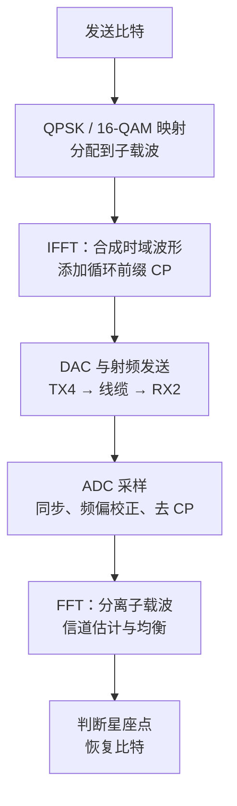

# OFDM 入门与实现过程

**OFDM 把一串数据分配给许多不同频率的子载波，同时发送，再由接收端分开。** 中文名称是“正交频分复用”（Orthogonal Frequency Division Multiplexing）。

可以先沿着五个概念学习：**比特 → 调制符号 → 子载波 → 波形 → 接收恢复**。

## 1. 从你已经看过的星座图开始

计算机中的数据最终表示为 `0`、`1`。调制把若干比特对应到一个可以发送的符号。

| 调制方式 | 每个调制符号表示的比特数 | 理想星座位置数 |
|---|---:|---:|
| QPSK | 2 | 4 |
| 16-QAM | 4 | 16 |

星座图横坐标为 I、纵坐标为 Q。先把它们理解成同一个点的两个坐标；程序用复数 `I + jQ` 记录这个点。

接收点受到噪声和硬件误差影响，会在理想位置附近形成点簇。你看到的四点簇和十六点簇，分别对应 QPSK、16-QAM。

详细解释：[[OFDM-01-比特、IQ与调制]]。

## 2. 把符号放到多个子载波上

假设一个教学系统有 4 个子载波，全部用于 QPSK 数据：

| 子载波编号 | 分配的比特 | 放入的内容 |
|---|---|---|
| 0 | `00` | 一个 QPSK 符号 |
| 1 | `01` | 一个 QPSK 符号 |
| 2 | `11` | 一个 QPSK 符号 |
| 3 | `10` | 一个 QPSK 符号 |

这四路在同一个有效符号时间内同时携带 8 个原始比特。这是简化示例，不是已确认的 P047Pro 硬件参数。

**一个 QPSK 符号是一个星座点；一个 OFDM 符号是一段波形，通常包含多个子载波上的调制符号。** 实际系统还要安排导频和空子载波。

并行传输让每一路能以较低符号速率工作，结合 CP 和均衡，有助于处理多径信道。并行路数本身不能用于推断同带宽下吞吐量成倍增加。

进一步阅读：[[OFDM-02-子载波与正交性]]。

## 3. 用 IFFT 合成时域波形

发射端先知道“每个频率位置放什么符号”，实际发送则需要“每个采样时刻输出什么数值”。

**IFFT 把子载波上的复数符号合成为时域 I/Q 采样；FFT 把时域采样分解回各个子载波位置。**



图中 TX4→RX2 对应本项目的 OFDM 回环路径。收发转换还包含实际 RFDC 数字处理和接口适配；流程图用于理解功能次序。

各个子载波最终叠加在同一条物理通路的信号中。软件实验见 [[OFDM-03-FFT与IFFT软件实验]]。

## 4. 正交性让子载波能够分开

OFDM 按特定频率间隔安排子载波，使它们在一个有效符号时间内互相正交。FFT 计算某一路时，其他路的贡献能够相互抵消。

常见子载波间隔为：

$$
\Delta f=\frac{1}{T_u}
$$

其中 $T_u$ 是不含 CP 的有效符号时间。频谱可以重叠；分离效果依赖接收窗口、频率同步和信道等条件。详见 [[OFDM-02-子载波与正交性]]。

## 5. 用 CP 处理多径造成的拖尾

信号可以沿不同路径到达接收端，形成较早和较晚的多个分量，这就是多径。晚到分量可能影响后面的符号。

CP 把符号末尾一段采样复制到前面：

```text
原始有效采样：        A B C D E F G H
加 CP 后：      G H | A B C D E F G H
                CP |     有效部分
```

接收端去掉 CP，再做 FFT。当 CP 覆盖相对时延扩展、定时合适且符号内信道近似不变时，可以用较简单的频域均衡处理多径。CP 也占用时间，需要权衡长度。

详见 [[OFDM-04-循环前缀CP与多径]]。

## 6. 实际接收机怎样恢复数据

| 处理环节 | 解决的问题 |
|---|---|
| 帧同步与符号同步 | 找到一帧和一个符号的起点 |
| 频偏校正 | 补偿收发频率不一致造成的持续旋转与载波间干扰 |
| 去 CP、FFT | 取出有效采样，分离子载波 |
| 信道估计 | 根据已知训练字段或导频，估计信道影响 |
| 均衡 | 补偿每路的幅度和相位变化 |
| 判决与比特恢复 | 确定接收点对应哪个发送符号 |

导频是双方事先知道的符号。接收端比较“应该收到什么”和“实际收到什么”，据此估计信道。详见 [[OFDM-05-同步、导频与均衡]]。

## 7. P047Pro 上谁完成这些工作

- **FPGA 的 PL**：执行已加载设计中的高速 OFDM 收发处理。
- **RFDC**：完成 ADC/DAC 转换及所配置的相关数字处理。
- **ARM 上的 Python/Jupyter**：加载配置、设置调制方式、采集数据并显示图形。

你此前选择 QPSK/16-QAM，是通过 Python 改变硬件控制寄存器；现成 FPGA 设计负责持续处理数据。详细对应见 [[OFDM-06-P047Pro实现与实验对应]]。

## 8. 自己实现时的顺序

1. 建立理想浮点模型：已知比特经调制、IFFT、CP 后，再反向恢复并比较。
2. 加入噪声、多径、未知定时和频偏，实现同步、估计与均衡。
3. 按发送与接收比特统计 BER；按帧统计 CRC 和漏帧情况。
4. 设计定点位宽、缩放和缓冲，做 RTL 仿真。
5. 集成 RFDC、时钟和接口，上板检查数据与时序。

## 看图时怎么联系原理

| 图 | 正在观察什么 |
|---|---|
| 时域图 | 合成信号在时间上的变化，具体取决于观察点 |
| 频谱图 | 信号能量在频率上的分布 |
| 星座图 | 相应观察点的复数符号分布 |

四个或十六个清晰点簇是直观证据；是否准确恢复发送数据，还要比较发送比特与接收比特。

> [!question]- 自检：星座图中的一个点等于一个 OFDM 符号吗？
> 一个点通常表示一个调制符号。一个 OFDM 符号是承载多个子载波符号的一段波形。你保存的 1024 个星座样本，不能直接当成 1024 个 OFDM 符号。

参考链接集中在 [[OFDM-07-参考资料与阅读顺序]]。返回 [[00-OFDM学习导航]]。
