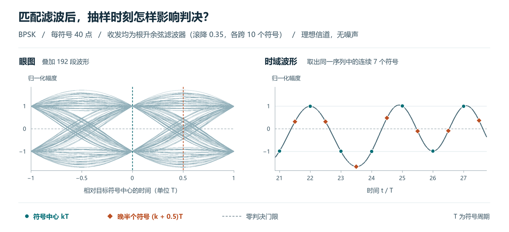

# 通信原理速查与实验笔记

**从一个接收问题开始。** 发射机把 `00` 放在 QPSK 星座图的右上角。接收机画出了四个清楚的点，为什么译出的比特还能错一半？如果载波相位偏了 90°，四个点仍然占据原来的四个位置，每个点代表的比特却变了。要判断一次通信是否成功，得知道**发了什么、在哪里观察、按什么规则恢复、用什么作比较**。这四个问题贯穿整篇笔记。

| 手头的任务 | 从这里读 |
|---|---|
| 第一次学，想看懂收发框图 | [从消息到波形](#从消息到波形) → [采样与频谱](#采样与频谱) → [数字调制与判决](#数字调制与判决) |
| 要算波特率、采样率、带宽或噪声 | [速率与带宽](#速率与带宽) · [噪声与误码](#噪声与误码) |
| 要做 AM、PCM、眼图或多载波实验 | [模拟调制](#模拟调制) · [采样与频谱](#采样与频谱) · [脉冲成形与眼图](#脉冲成形与眼图) · [多径与多载波](#多径与多载波) |
| 想第一次跑通收发，手边只有电脑 | [三个可以直接运行的实验](#三个可以直接运行的实验)，从实验二的无噪声 QPSK 开始 |
| 看到频谱镜像、星座旋转、误码地板、CRC 失败 | [实验排错表](#实验排错表)；也可用 Ctrl+F 搜索现象或缩写 |

## 从消息到波形

`消息 → 信源编码 → 成帧、检错与纠错编码 → 符号映射 → 脉冲成形 → 上变频 → 信道`

`信道 → 下变频与滤波 → 同步、信道估计与均衡 → 符号判决 → 纠错译码、验帧 → 恢复消息`

| 接口 | 此处的数据 | 可做的最小检查 |
|---|---|---|
| 消息 → 比特 | 文字可用 UTF-8 编成字节；声音可用 PCM 变成采样码字 | 先发已知的一个字节，写明高位还是低位先发 |
| 比特 → 符号 | 映射表每次取一组比特，选一个允许的幅度、相位或频率 | 手算一个符号，通过映射和反映射还原 |
| 符号 → 波形 | 每个符号激发一个脉冲，连续脉冲相加；一个符号可以对应多个采样 | 对照采样率和符号率，检查数组长度与时长 |
| 波形 → 接收符号 | 接收机寻找帧头、估计频差、选定抽样时刻，并补偿信道 | 标清观察点，分别保存同步前波形和均衡后符号 |
| 接收符号 → 消息 | 判决器给出比特或可信度，译码器利用冗余，CRC 检查整帧 | 先对齐同一帧的已知载荷，再数错比特和错帧 |

**复基带 I/Q。** 写成 $x(t)=I(t)+jQ(t)$，一个采样就同时记录幅度 $|x|$ 和相位 $\arg x$。本文采用的上变频约定为 $s(t)=\Re\{x(t)e^{j2\pi f_ct}\}=I(t)\cos(2\pi f_ct)-Q(t)\sin(2\pi f_ct)$。接收端用同频参考下变频并低通可取回 I、Q（常数增益取决于实现）。检查 I/Q 顺序的简单办法是输入已知正频率复单音 $e^{j2\pi f_0 n/F_s}$，在此约定下它逆时针转，频谱峰在 $+f_0$。

## 速率与带宽

| 符号 | 读法和单位 | 怎么算 |
|---|---|---|
| $M,k$ | 星座点数、每符号编码比特数 | 常见二进制等长映射满足 $k=\log_2 M$ |
| $T_s,R_s$ | 符号周期（s）、符号率（Bd） | $R_s=1/T_s$；1 MBd 即每秒一百万个符号 |
| $F_s,L$ | 采样率（Sa/s）、每符号采样数 | 单载波均匀采样 $L=F_s/R_s$；1 个复采样含一对 I/Q 值 |
| $r,R_b$ | 码率、信息比特率（bit/s） | $r=K/N$ 表示 $K$ 个信息位编码为 $N$ 位；全时发送数据时 $R_b=rkR_s$ |
| $B,\eta$ | 占用带宽（Hz）、频谱效率（bit/s/Hz） | $\eta=R_{\rm net}/B$；净速率还需扣除前导、导频、帧头等开销 |

**贯穿算例。** 单载波 QPSK 每符号 2 个编码位，$R_s=1$ MBd、码率 $r=1/2$。映射器每秒取 2 Mbit，所含信息为 1 Mbit。若整帧只有 80% 的符号装载这种编码后的有效数据，净速率为 0.8 Mbit/s。取 $L=4$，需要 4 MSa/s 的复采样。若采用滚降 $\alpha=0.25$ 的理想升余弦总响应，射频正频带的零点到零点带宽为 1.25 MHz，净频谱效率是 $0.8/1.25=0.64$ bit/s/Hz。

**dB 的三个用法。** 功率比用 $10\log_{10}(P_2/P_1)$，同阻抗下的电压比用 $20\log_{10}(|V_2/V_1|)$，绝对功率用 $P_{\rm dBm}=10\log_{10}(P/1\,\mathrm{mW})$。0 dBm 对应 1 mW，功率翻倍约加 3 dB。做链路预算可直接加减，例如发射 −10 dBm，线缆损耗 3 dB，衰减器损耗 20 dB，则接收端约 −33 dBm。

## 采样与频谱

1. **采样决定时间分辨率。** 对限于 $0\sim W$ Hz 的实低通信号，理想采样界限为 $2W$；实际取 $F_s>2W$，给模拟抗混叠滤波器留出过渡带。实余弦 6 kHz 用 8 kSa/s 采样后，样本与 2 kHz 余弦完全相同。采样前滤除带外信号才能避免这种混叠。复基带通常用 $[-F_s/2,F_s/2)$ 标频，注明带宽是单边截止频率还是整个频带宽度。
2. **量化决定幅度分辨率。** $q$ 位均匀量化给出 $2^q$ 个等级。满量程跨度 $V_{\rm pp}$ 对应步长 $\Delta=V_{\rm pp}/2^q$。无过载、四舍五入量化且误差近似均匀时，误差功率约 $\Delta^2/12$。满幅正弦的理想量化信噪比约 $6.02q+1.76$ dB。削顶、输入太小或模拟噪声都会改变测量值。
3. **PCM 把幅度等级写成比特。** 抽样 → 量化 → 二进制编码。单声道 8 kSa/s、每样本 8 bit 的原始 PCM 为 64 kbit/s。压缩属于信源编码。对概率为 $p_i$ 的离散符号，熵 $H=-\sum_i p_i\log_2 p_i$ 衡量平均信息量；对无记忆源，这是无损编码可趋近的平均 bit/源符号下界。
4. **FFT 给出有限时间内的频谱。** 采 $N$ 点时，记录长 $N/F_s$，原始 FFT 的频点间隔 $F_s/N$。观察实信号时正负频率共轭对称；复 I/Q 可正负不对称。单音在记录内不足整数个周期时会泄漏到邻近频点。Hann 窗可降低旁瓣但加宽主瓣；补零只能加密谱线上取样，分开近邻单音要有足够长的有效记录。功率谱密度单位可用 W/Hz，对频带积分得到功率。

## 模拟调制

设消息 $m(t)$ 的最高频率为 $W$，载波为 $f_c$。乘以余弦会把基带频谱平移到 $\pm f_c$ 附近，这个现象也解释了接收机为什么能用混频把信号搬回零频。

| 方式 | 发射波形或占用带宽 | 接收时看什么 |
|---|---|---|
| 常规 AM（带载波双边带） | $A[1+\mu m(t)]\cos(2\pi f_ct)$，$m$ 的峰值归一化为 1；正频带宽 $2W$ | 包络随消息起伏。单音且 $0\le\mu\le1$ 时，由包络峰谷得 $\mu=(A_{\max}-A_{\min})/(A_{\max}+A_{\min})$。过调制时包络折返，包络检波失真 |
| DSB-SC（抑制载波双边带） | $m(t)\cos(2\pi f_ct)$，带宽 $2W$ | 与同频同相载波相乘再低通。理想零均值消息的频谱里没有单独载波线 |
| SSB（单边带） | 保留上边带或下边带，带宽约 $W$ | 节省带宽，解调时本振频率偏差会直接搬移恢复的音频 |
| FM / PM（角度调制） | FM 的瞬时频偏与消息成正比，PM 的相位偏移与消息成正比。FM 常用 Carson 近似 $B\approx2(\Delta f_{\rm peak}+W)$ | 理想幅度恒定。FM 可从解缠后的相位斜率恢复消息；PM 看相对载波的相位 |

**示波器实验。** 用 1 kHz 正弦调制 20 kHz 载波，设 $\mu=0.5$、采样率 200 kSa/s。在时域应看到每毫秒一个包络周期；在频域应找到 19、20、21 kHz 三条正频率谱线，两条边带的幅度各为载波的 $\mu/2=0.25$ 倍。把 $\mu$ 改为 1.2，观察包络谷部与原消息的对应关系。测频率读横轴，测调制度读线性电压幅度。

## 数字调制与判决

| 方式 | 一个符号由什么区分 | 实验中的取舍 |
|---|---|---|
| 二进制 ASK / OOK | 两种幅度；OOK 用有、无载波表示两态 | 包络判决简单，阈值易随信道增益漂移 |
| 二进制 FSK | 两种频率 | 可比较两个频带中的能量做非相干检测；频率间隔影响带宽和可分辨性 |
| BPSK / QPSK | 2 / 4 种相位，每符号 1 / 2 bit | 相干接收要有相位参考；Gray QPSK 的两路判决可分别按 I、Q 正负完成 |
| 16-QAM / 64-QAM | 幅度与相位联合携带 4 / 6 bit | 同符号率提高比特率；固定平均能量时点距缩小，对噪声、非线性和相位误差更敏感 |

**手算一次 QPSK。** 约定第一位控制 I、第二位控制 Q，0 取正、1 取负，各轴幅度为 $1/\sqrt2$。于是 $00\mapsto(1+j)/\sqrt2$，$01\mapsto(1-j)/\sqrt2$。收到 $0.5-0.9j$，符号已同步且均衡，就判为 `01`。在等概符号、圆对称加性白高斯噪声下，最近欧氏距离判决使符号错误概率最小。Gray 映射让相邻点只差一位，最常见的近邻判错只损失一位。软判决还向译码器传递可信度，靠近轴的点相应位可信度较低。

**基带线路码。** 在有线数字实验里，同一比特流可直接用电平表示。单极性 NRZ（不归零）用高、低电平，双极性电平映射可取 $+A/-A$；长串相同比特时都缺少定时跳变。Manchester（曼彻斯特）在每个位周期中点强制跳变，便于提取时钟，代价是更快的跳变和更宽的典型频谱。实验前用一段 `00001111` 核对编码极性和中点跳变方向。

## 脉冲成形与眼图

将每个符号 $a_k$ 换成一个脉冲 $p(t)$，得到 $x(t)=\sum_k a_k p(t-kT_s)$。带宽有限时，脉冲会拖到相邻符号。只要**整条链路的总脉冲响应**满足 $g(0)=1$，在其他整数倍符号时刻 $g(mT_s)=0$，就能在正确的抽样时刻消除码间串扰（ISI）。这叫奈奎斯特零 ISI 准则，与前面的采样定理解决不同问题。

- **成对滤波。** AWGN 下，匹配滤波器取发射脉冲的共轭时间反转（允许整体延时），在指定抽样点使输出信噪比最大。常用发端、收端各一个根升余弦滤波器（RRC），级联得到升余弦（RC）响应；实际有限长截断会留下少量残余 ISI。
- **滚降系数。** 对上述响应，单边基带截止频率 $W=(1+\alpha)R_s/2$，对应射频正频带宽为 $2W$。$\alpha=0$ 给出理想低通奈奎斯特上限 $R_s=2W$；增大 $\alpha$ 要用更多带宽，时域尾部衰减也更快。
- **画眼图。** 在匹配滤波输出端，把实部按约两个符号周期切段，叠在同一时间轴上。眼口最高处给出较大的电压判决余量，眼口宽度反映对抽样时刻误差的容忍度。先扣除滤波延迟，再找符号中心。对称 $P$ 抽头 FIR 的群时延为 $(P-1)/2$ 个采样，串联时相加。



读图时先找零电平判决线。图中使用无噪声 BPSK，收发 RRC 滚降均为 0.35，每符号 40 点。补偿滤波延迟后，在符号中心判决，192 个符号全部正确；同一串数据晚半个符号抽样，错了 45 个。右图 $k=21$ 处发的是 −1，两次读数约为 −0.99 和 +0.31。光是改变抽样时刻，判决就越过了零门限。

## 噪声与误码

| 要回答的问题 | 量与条件 |
|---|---|
| 接收功率够不够？ | $\mathrm{SNR}=P_s/P_n$。白噪声在等效噪声带宽 $B_n$ 内的功率为 $N_0B_n$（取相应的单边物理噪声谱密度）；改变测量带宽就会改变 SNR |
| 每个比特分到了多少能量？ | $E_s$ 是平均符号能量，$E_b$ 以信息位计。忽略帧开销，$E_s=rkE_b$，等价地 $E_b/N_0=\mathrm{SNR}\,B_n/R_b$。非编码 QPSK 的 $E_s/N_0$ 比 $E_b/N_0$ 高 3.01 dB |
| 误码率该和谁比？ | 相干 BPSK 或 Gray QPSK、等概未编码比特、理想同步且仅有 AWGN 时，$P_b=\tfrac12\operatorname{erfc}(\sqrt{E_b/N_0})$，根号内代线性值。例如 6 dB 对应 $P_b\approx0.00239$。[理论曲线与假设](https://www.mathworks.com/help/comm/ug/analytical-expressions-used-in-berawgn-function-and-bit-error-rate-analysis-app.html) |
| 误差有多大？ | BER = 错比特数 / 比较的已对齐比特数；SER 用符号作分母。PER = 失败包数 / 发送包数，要说明丢失、未同步和 CRC 失败如何计入。比较译码前后 BER 时分别记录观察点 |
| 星座散开多少？ | 参考符号 $s_i$ 与对齐后的测量 $z_i$ 对应时，$\mathrm{EVM}_{\rm rms}=\sqrt{\sum_i\lvert z_i-s_i\rvert^2/\sum_i\lvert s_i\rvert^2}$。乘 100% 报百分比，或取 $20\log_{10}$ 报 dB。注明是否已补偿增益和相位；按最近点作参考会掩盖部分判错 |
| 给定资源的理论极限？ | 带宽 $B$ 的理想带限 AWGN 信道容量 $C=B\log_2(1+\mathrm{SNR})$ bit/s，SNR 用线性值。例如 $B=1$ MHz、SNR = 10 dB，$C\approx3.46$ Mbit/s。接近容量需要合适的编码和足够长的码块 |

**如何解释“0 错误”。** 写成“本次比较 100 000 bit，观察到 0 错”。在独立、等错误概率的近似下，单侧 95% 置信上限约为 $3/N$，此处约 $3\times10^{-5}$。衰落造成成串错误时，还要增加独立帧和信道实现数。

## 多径与多载波

**信道会留下不同指纹。** 衰减改变幅度，噪声使点簇扩散，反射路径把同一信号的延迟副本叠回来。离散模型 $y[n]=\sum_\ell h_\ell[n]x[n-d_\ell]+w[n]$ 中，$d_\ell$ 是以采样计的时延，$h_\ell[n]$ 是可随时间变化的复增益。时延扩展相对符号周期越大，ISI 通常越明显；运动引起的多普勒会让相位随时间变化。各频率近似经历同一复增益称平坦衰落，频带内增益明显不同称频率选择性衰落。

| 接收任务 | 可以怎么做 | 在哪儿找证据 |
|---|---|---|
| 帧同步与符号定时 | 用已知前导做相关找帧头，在眼口处取样；长帧持续跟踪采样时钟 | 相关峰给候选起点，峰后应读出正确帧头；观察峰位是否逐帧移动 |
| 载波同步 | 频偏 $\Delta f$ 使复样本多乘 $e^{j2\pi\Delta f n/F_s}$。先从训练段估计频差，再用导频跟踪余相 | 已知符号去调制后相位随时间的斜率为 $2\pi\Delta f$（rad/s） |
| 信道估计与均衡 | 在非零已知导频上用 $\hat H=Y_p/X_p$ 估信道，再插值到数据位置。零迫（ZF）用 $Y/\hat H$ 反推符号 | 比较均衡前后星座。深衰落处除以小数会放大噪声，MMSE 均衡还利用信噪水平折中处理 |

**OFDM 如何处理回波。** 将数据符号填进多个子载波，用 $N$ 点 IFFT 生成时域块。有效时长 $T_u=N/F_s$，子载波间隔 $\Delta f=1/T_u$，因此在这个观察窗内各载波正交。复制块尾 $N_{\rm CP}$ 个样本到块首作循环前缀（CP）。若信道在块内近似不变、定时正确且 $N_{\rm CP}\ge L_h-1$（$L_h$ 为离散信道长度），去 CP 后的线性卷积等效为块内循环卷积。FFT 后便有 $Y[k]=H[k]X[k]+W[k]$，每个子载波可单独均衡。频偏或过快时变会引起载波间干扰（ICI）；时域多载波叠加还会带来较高的峰均功率比（PAPR），削顶会使频谱再生、星座变差。

**算一帧的速率。** $F_s=1$ MSa/s、$N=64$、CP 为 16 点，则 $T_u=64$ µs、间隔 15.625 kHz、总符号时长 80 µs。若每块有 48 个数据子载波，其余用作导频或置空，采用未编码 QPSK，每块传 96 bit，连续数据块速率为 1.2 Mbit/s。另加帧前导时还要按整帧时间重算。

**复用与编码。** TDM 按时隙共享链路，FDM 按频带，CDM 用不同扩频码并靠相关区分；OFDM 用正交子载波，谱形允许重叠。信道编码用冗余保护数据，例如 (7,4) 汉明码每 4 个信息位产生 7 个编码位，最小距离 3，可纠正每个码字内的一位错误。交织将突发错分散到多个码字，代价是延迟。CRC 用生成多项式计算余数以检错；若协议支持，接收方可据此请求重传（ARQ）。同步、纠错和检错各有自己的观察点。

## 三个可以直接运行的实验

**准备。** 在装有 NumPy 的 Python 3 Notebook 中，每个实验各用一个单元格，互相独立。普通 Python 环境也可把任一段存为 `.py` 后运行。若提示找不到 NumPy，在目标 Python 环境执行 `python -m pip install numpy`；Notebook 中可用 `%pip install numpy`。三段程序都只使用电脑生成的数据。

### 实验一　用频谱找到混叠

**问题。** 采到 2 kHz 的峰，输入是否一定为 2 kHz？保持模拟输入为 6 kHz，分别以 8、16 kSa/s 采样。每次记录一秒，用实信号单边幅度谱找峰。

```python
import numpy as np

for fs in (8000, 16000):
    t = np.arange(fs) / fs
    x = np.cos(2 * np.pi * 6000 * t)
    freq = np.fft.rfftfreq(len(x), d=1/fs)
    amp = np.abs(np.fft.rfft(x)) / len(x)
    amp[1:-1] *= 2  # 偶数点实信号；直流和奈奎斯特频点不加倍
    peak = np.argmax(amp)
    print(fs, "Sa/s →", freq[peak], "Hz，幅度", round(amp[peak], 3))
```

**验收。** 两次分别读出 2000 Hz 和 6000 Hz，幅度均为 1。把输入改为 1 kHz 再测，两个采样率下都应看到 1 kHz。这组对照能说明第一次的 2 kHz 来自折叠。若只拿到第一份样本而缺少输入带宽信息，无法仅凭它区分 2 kHz 与 6 kHz。

### 实验二　把比特发出去，再数回来

**问题。** 怎样证明 QPSK 映射、判决和加噪声三步都正确？先做理想闭环，再加入一个已知相位偏差，最后单独加噪声。这里直接模拟匹配滤波后的符号抽样值，每个复符号一点，$E_s=1$、$E_b=1/2$。复噪声 $n=n_I+jn_Q$ 的两路独立分量方差均取 $N_0/2$。

```python
from math import erfc, sqrt
import numpy as np

rng = np.random.default_rng(42)
bits = rng.integers(0, 2, size=(100_000, 2))  # 两列分别控制 I、Q
tx = ((1 - 2*bits[:, 0]) + 1j*(1 - 2*bits[:, 1])) / sqrt(2)

def count_errors(rx):
    decisions = np.column_stack((rx.real < 0, rx.imag < 0))
    return np.count_nonzero(decisions != bits)

print("理想 / 转 90° / 校正后的错比特数",
      count_errors(tx), count_errors(1j*tx), count_errors((-1j)*(1j*tx)))
print("Eb/N0(dB)   错比特/总比特     实测BER     理论BER")
for db in (0, 3, 6):
    gamma_b = 10**(db/10)
    n0 = 0.5 / gamma_b
    noise = sqrt(n0/2) * (rng.normal(size=tx.size) + 1j*rng.normal(size=tx.size))
    errors = count_errors(tx + noise)
    print(f"{db:>5}       {errors:>5}/{bits.size}     "
          f"{errors/bits.size:.5f}     {0.5*erfc(sqrt(gamma_b)):.5f}")
```

**验收。** 第一行应为 0、100000、0。按本映射，旋转 90° 后，每个符号恰错一位，四个点的位置集合仍一样。0、3、6 dB 的理论 BER 依次约为 0.07865、0.02288、0.00239。本次在 6 dB 实测 486/200000，约为 0.00243。若实测曲线整体水平偏约 3 dB，先检查 QPSK 的每符号两位，以及复噪声的 I、Q 方差，再考虑增加数据量。

### 实验三　让回波越过循环前缀

**问题。** 一条延迟 8 点的回波，CP 取 8 点与 4 点有什么区别？连续发送两个不同 OFDM 块，让前块的尾部自然进入后块；只在第二块测量。保持无噪声、已知信道、理想定时，唯一改变 CP 长度。

```python
import numpy as np

rng = np.random.default_rng(7)
N = 64
axes = rng.choice([-1, 1], size=(2, N, 2))
X = (axes[:, :, 0] + 1j*axes[:, :, 1]) / np.sqrt(2)
x = np.fft.ifft(X, axis=1)
h = np.zeros(9)
h[[0, 8]] = [1.0, 0.6]
H = np.fft.fft(h, N)

for cp in (8, 4):
    blocks = np.concatenate((x[:, -cp:], x), axis=1)
    y = np.convolve(blocks.ravel(), h)
    start = (N + cp) + cp  # 跨过第一块及第二块自己的 CP
    Y = np.fft.fft(y[start:start+N])
    recovered = Y / H
    evm = np.linalg.norm(recovered - X[1]) / np.linalg.norm(X[1])
    print(f"CP={cp} 点，均衡后 RMS EVM={evm:.3e}")
```

**验收。** 本次 8 点 CP 的均衡后 EVM 约为 $3.08\times10^{-16}$，只剩浮点舍入误差；4 点时升至 28.5%。再把回波增益 0.6 改成 0，两种 CP 都应恢复到舍入量级。这个对照能把问题定位到延迟路径与 CP 的组合。教学代码使用全部 64 个频点装数据，便于逐点比较。

## 实验排错表

先固定发端数据和随机种子，把链路退回无噪声理想闭环。从发端往接收端逐级找**第一个与预期不符的数组**；每次只恢复一种影响，保留前后两个结果。

| 看见的现象 | 最快的区分方法 | 查什么、改哪里 |
|---|---|---|
| 频谱峰出现在意外的位置，或左右镜像 | 输入已知正频率复单音；比较谱峰和相邻采样的相位增量 | 核对有效采样率、抽取倍数、I/Q 顺序、Q 符号及 `fftshift` 是否同时作用于横轴与频谱 |
| 星座成圆或绕中心转 | 按时间切成短段，对已知导频计算接收与发射的相位差 | 相位差随时间积累查频偏；稳定角度查固定相位或载波恢复的象限模糊；先补偿再判决 |
| 四簇清楚，BER 却接近 0.5 | 发固定帧头与已知比特串，列出前几个发射符号和接收判决 | 先查帧对齐、抽样点，再查映射表、位序、I/Q 对调和 90° 旋转 |
| 星座像线团，眼口闭合 | 只画匹配滤波后每符号一个点；扫描一个符号周期内的抽样相位 | 正确相位恢复点簇时查定时；各相位仍差时，关闭多径或核对 RRC 参数、滤波延迟 |
| 点簇外沿被切平，频谱两侧冒肩 | 看时域峰值及直方图，随后降低发射幅度或接收增益再测 | 大量样本贴近满量程常提示 DAC、放大器、ADC 或定点运算饱和 |
| BER 曲线比理论整体错开 | 计算映射后平均 $\lvert x\rvert^2$ 和实测 $\mathrm{mean}(\lvert y-x\rvert^2)$ | 核对 $E_b/N_0$、$E_s/N_0$、每采样点 SNR 的定义，以及过采样和滤波能量归一化 |
| 高 SNR 下 BER 不再下降（误码地板） | 去掉噪声，固定一帧，逐次关闭频偏、多径、量化；检查误码位置 | 固定周期错位查时钟与帧结构；集中在深衰落频点查均衡和导频；跨块错误查 CP 和窗口 |
| 载荷看起来对，CRC 总失败 | 取同一短帧，在收发两端打印参与 CRC 运算的确切字节 | 对照 CRC 多项式、初值、位反射、末异或、字节序、是否覆盖帧头 |
| 图上点簇稳定，却无法报 BER | 查看是否同时保存了发端参考、帧号和接收判决 | 只有星座时可描述点数和扩散；取得已知帧并对齐后再统计 BER |

**一行实验记录。** 填上「软件 / RTL 仿真 / 板测｜数据源及观察点｜$F_s$、$R_s$、调制与帧长｜信道或接线、增益｜同步与均衡方式｜错误数 / 比较总数｜保存位置」。这足以让同学判断两次曲线能否直接对照。

**在本仓库继续练习。** 想把实验三扩成完整收发，可接着做含数据子载波和导频的 [FFT 与 IFFT 软件实验](OFDM学习笔记/专题/OFDM-03-FFT与IFFT软件实验.md)。想看真实观察点，可对照 P047Pro 保存的 QPSK 和 16-QAM 星座，两组各 1024 个复数点，来源是接收星座观察接口；用这两组数据可以练习重绘和观察点簇。复算板测 BER 还需要同一帧的发送比特及对齐信息。[星座采集与重绘记录](OFDM学习笔记/实操记录/实操-02-星座采集保存与重绘.md)

需要追问“为什么匹配滤波、量化和最近点判决有这些性质”时，可按主题查采样、量化、信号空间和检测章节。[MIT 通信原理课程讲义](https://ocw.mit.edu/courses/6-450-principles-of-digital-communications-i-fall-2006/)
